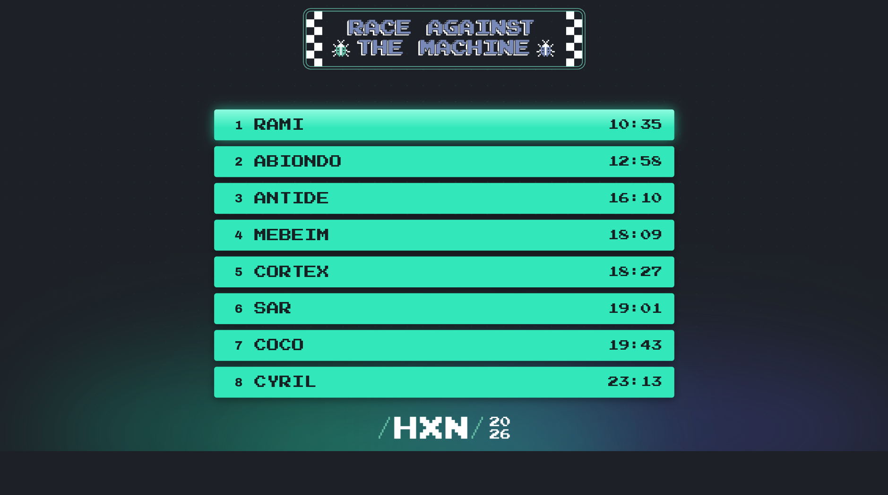
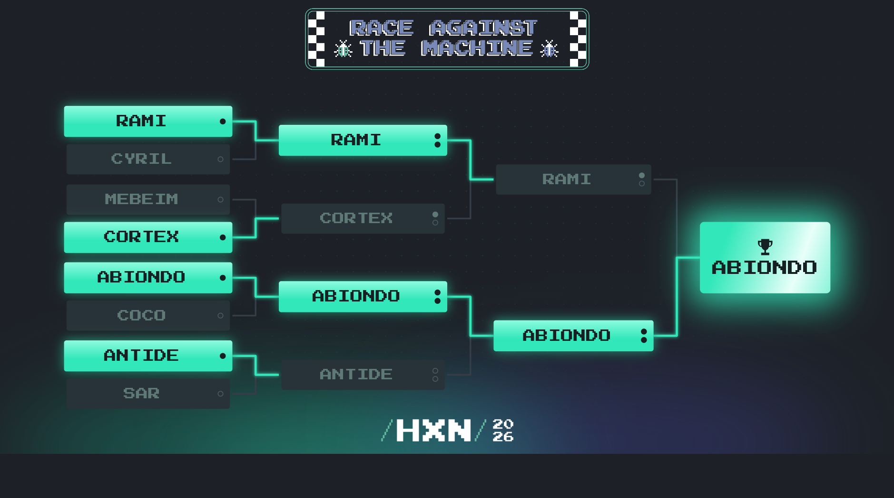

# Hexacon Speedrun 2026

This repository contains the challenges played during the Hexacon Speedrun 2026 CTF event.

## Challenges

- **Qualifier**
  - [customcpu](challenges/customcpu/) (`misc`)
- **Quarterfinals challenges (BO1)**
  - [echo_chamber](challenges/echo_chamber/) (`pwn`)
  - [imposter](challenges/imposter/) (`rev`)
  - [dompwnify](challenges/dompwnify/) (`pwn`)
  - [shader](challenges/shader/) (`rev`)
- **Semifinals challenges (BO3)**
  - Pool #1
    - [bsod](challenges/bsod/) (`rev`)
    - [slippery](challenges/slippery) (`web`)
    - [vault](challenges/vault) (`pwn`)
  - Pool #2
    - [checksum](challenges/checksum) (`pwn`)
    - [secure_int](challenges/secure_int) (`crypto`)

- **Final challenges (BO3)**
  - [unchained](challenges/unchained/) (`rev`)
  - [numconverter](challenges/numconverter/) (`pwn`) (aborted, replaced by `babypf`)
  - [babypf](challenges/babypf/) (`rev`)
  - [tensorflaw](challenges/tensorflaw/) (`pwn`)

## Qualifiers results



## Final results



## Testing challenges

```shell
CHALLENGE="bsod" # For example
make -C challenges/$CHALLENGE
# If the challenge requires a remote environment, spawn a container
if [ -d challenges/$CHALLENGE/docker ]; then
  docker compose -f challenges/$CHALLENGE/docker/docker-compose.yml up --build
fi
```

The files given to the players are located inside `challenges/$CHALLENGE/dist` directory.